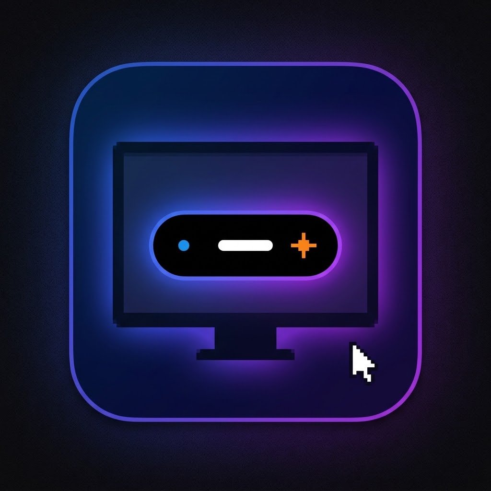

# Smart Island for Windows 🏝️

<p align="center">
  
</p>

<p align="center">
  <strong>Современный, легковесный Dynamic Island оверлей для Windows 10/11</strong><br />
  Объединяет управление медиа, аудиоустройствами, Docker-контейнерами и универсальным VPN-клиентом в одном компактном островке у кромки экрана.
</p>

<p align="center">
  
  
  
  
  
  
  
</p>

---

## 💡 О проекте и философия

**Smart Island** родился из практической потребности решить одну простую задачу: **собственное удобство и продуктивность**.

В процессе ежедневной работы за компьютером постоянно приходится переключаться между разными окнами и утилитами: проверять статус локальных Docker-контейнеров, переключать наушники или колонки, ставить на паузу музыку или переключать трек, подключаться к прокси или VPN, сверяться с уведомлениями.

Вместо того чтобы держать открытыми десятки вкладок, утилит в системном трее и тяжелых панелей управления, все эти механизмы были объединены **в едином месте** — аккуратном, быстром и отзывчивом островке, который всегда под рукой у верхней кромки экрана.

### Взгляд в будущее и развитие
Проект изначально создавался «для себя», но архитектура заложена так, чтобы развиваться и расширяться со временем:
- 🚀 **Постоянное улучшение**: добавление новых модулей, которые могут быть полезны не только автору, но и широкому кругу разработчиков и пользователей (системный мониторинг CPU/RAM/GPU, быстрые заметки, интеграции с сервисами).
- 🧩 **Модульность**: система виджетов построена по принципу плагинов — каждый модуль изолирован, имеет собственные размеры и может быть кастомизирован или отключен.
- 🤝 **Открытость для сообщества**: обратная связь, идеи и предложения приветствуются, чтобы сделать инструмент удобнее для всех.

---

## ✨ Основные возможности

### 🏝️ Интерактивный Dynamic Island
- **Apple-подобный дизайн**: капсульная форма, плавные скругления, эффект характерных боковых «ушек» (concave ears) и эстетичный Glassmorphism.
- **Пружинная физика 60 FPS**: анимации масштабирования и перемещения реализованы на физическом движке Framer Motion (`stiffness: 300, damping: 28`).
- **Свернутый режим (Карусель)**: переключение свайпом или колесиком мыши между медиаплеером, статусом Docker и VPN с индикаторами-точками.
- **Таймаут неактивности**: автоматически сворачивается в ультратонкую эстетичную линию (3px), не отвлекая от работы.
- **Игровой режим (Auto-hide)**: интеллектуально скрывается при запуске полноэкранных игр и 3D-приложений (`DirectX/D3D`), чтобы не мешать игровому процессу.
- **Светлая и темная темы**: полноценная поддержка тем с мгновенным переключением.

### 🛡️ VPN & Прокси (Гибридный Dual Engine)
Поддерживает современные стандарты обхода цензуры на уровне лучших универсальных клиентов (таких как Incy, v2rayN, NekoBox):
- **Двухъядерная архитектура (Xray-core + sing-box)**:
  - **Xray-core v26.10.31**: нативная поддержка **VLESS Reality** с передовым **Post-Quantum шифрованием** (`mlkem768x25519plus`, `pqv=...`, `flow=xtls-rprx-vision`), **VMess**, **Trojan**, **Shadowsocks** (включая 2022 blake3).
  - **sing-box v1.14**: для высокоскоростных протоколов нового поколения **Hysteria 2** (`hy2://`) и **TUIC v5** (`tuic://`).
- **Умная защита от петель маршрутизации (Direct Server Bypass)**: трафик к IP-адресу сервера и локальным сетям направляется напрямую, благодаря чему веб-панели управления (например, 3X-UI) и локальные ресурсы остаются доступными всегда.
- **Два режима работы**:
  - *Системный прокси* (`127.0.0.1:7890`) — работает без прав администратора, с мгновенным уведомлением подсистемы Windows WinINet.
  - *TUN-режим* — полный перехват трафика системы через виртуальный сетевой интерфейс Wintun.
- **Реальный замер пинга**: встроенный замер круговой задержки до Cloudflare/Google через прокси-туннель с отображением миллисекунд прямо на островке.
- **Безопасное завершение**: привязка дочерних процессов к Windows Job Object гарантирует выключение ядра и сброс прокси при закрытии приложения.

### 🎵 Управление медиа (Windows GSMTC)
- Интеграция с системным Windows Global System Media Transport Controls (WinRT).
- Отображение текущего трека, исполнителя и обложки альбома в реальном времени.
- Управление: воспроизведение, пауза, предыдущий и следующий треки.
- В свернутом состоянии — живой анимированный эквалайзер и миниатюрная обложка.

### 🔊 Аудиомикшер и устройства (Audio Switcher)
- Отображение активных устройств воспроизведения (наушники, динамики) и записи (микрофоны).
- Переключение устройства по умолчанию в один клик через недокументированный COM-интерфейс Windows `IPolicyConfig`.
- Двусторонняя синхронизация аппаратного слайдера громкости через Windows CoreAudio (`IAudioEndpointVolume`).

### 🐳 Docker Manager
- Асинхронное подключение к локальному демону Docker через Windows Named Pipe (`//./pipe/docker_engine`).
- Список контейнеров с их статусами, образами и проброшенными портами.
- Быстрый запуск, остановка и перезапуск контейнеров с визуальной индикацией выполнения.

### 🔔 Центр уведомлений (Notifications)
- Мониторинг системных тостов через WinRT `UserNotificationListener`.
- Всплывающий интерактивный баннер при поступлении нового уведомления.
- История последних уведомлений и синхронизированная очистка с Windows Action Center.

### ⚙️ Гибкая настройка
- Свободное включение, отключение и Drag-and-Drop сортировка вкладок.
- Выбор целевого монитора в многомониторных конфигурациях.

---

## 🏗️ Архитектура системы

```
┌──────────────────────────────────────────────────────────────────────────────┐
│                      FRONTEND: WebView2 (React 19 + TS)                      │
│  ┌───────────────┐ ┌────────────────┐ ┌────────────────┐ ┌────────────────┐  │
│  │ Island Shell  │ │ Modular Router │ │  Zustand Store │ │ Framer Motion  │  │
│  │ (Physics/Size)│ │  (6 Modules)   │ │  (State/Sync)  │ │ (Spring 60fps) │  │
│  └───────┬───────┘ └────────┬───────┘ └────────┬───────┘ └────────────────┘  │
└──────────┼──────────────────┼──────────────────┼─────────────────────────────┘
           │ IPC (Invoke)     │ Tauri Events     │ WebSocket / Delay Check
┌──────────▼──────────────────▼──────────────────┼─────────────────────────────┐
│                     CORE BACKEND: Tauri v2 (Rust)                            │
│  ┌────────────────┐ ┌────────────────┐ ┌───┴─────────────┐ ┌──────────────┐  │
│  │ Window Manager │ │ WinRT / COM    │ │ Docker Client   │ │ Dual Engine  │  │
│  │ (Win32 Hooks)  │ │ (GSMTC / Audio │ │ (bollard via    │ │ Sidecar Mgr  │  │
│  │                │ │  Toast/Notify) │ │  Named Pipe)    │ │              │  │
│  └────────────────┘ └───────┬────────┘ └───────┬─────────┘ └──────┬───────┘  │
└─────────────────────────────┼──────────────────┼──────────────────┼──────────┘
                              │                  │                  │ Spawn / Job
┌─────────────────────────────▼──────────────────▼──────────────────▼──────────┐
│                         ОС И ВНЕШНИЕ ПОДСИСТЕМЫ                              │
│   [WinRT GSMTC / CoreAudio]     [//./pipe/docker_engine]     [Xray / sing-box]│
└──────────────────────────────────────────────────────────────────────────────┘
```

---

## 📚 Использованные библиотеки, ядра и благодарности

Проект опирается на выдающиеся открытые решения и библиотеки:

### Прокси-ядра и сетевой стек
* **[Xray-core](https://github.com/XTLS/Xray-core)** — эталонное ядро от проекта XTLS. Отвечает за поддержку передовых технологий VLESS Reality, Vision flow и Post-Quantum шифрования ML-KEM/Kyber.
* **[sing-box](https://github.com/SagerNet/sing-box)** — универсальная и быстрая платформа прокси от SagerNet. Используется для протоколов Hysteria 2, TUIC и высокопроизводительной TUN-маршрутизации.
* **[Wintun](https://www.wintun.net/)** — высокопроизводительный нативный TUN-драйвер для Windows от разработчиков WireGuard.

### Десктоп и системная интеграция (Rust)
* **[Tauri v2](https://github.com/tauri-apps/tauri)** — легкий, безопасный и сверхбыстрый фреймворк для сборки настольных приложений на Rust.
* **[windows-rs](https://github.com/microsoft/windows-rs)** — официальные Rust-биндинги от Microsoft для взаимодействия с Win32, WinRT, COM и системными событиями.
* **[bollard](https://github.com/fussybeaver/bollard)** — асинхронный Docker API клиент для Rust с поддержкой Windows Named Pipes.
* **[winreg](https://github.com/gentoo90/winreg-rs)** — библиотека для работы с реестром Windows (управление системным прокси).

### Пользовательский интерфейс (Frontend)
* **[React 19](https://react.dev/)** & **[TypeScript](https://www.typescriptlang.org/)** — основа пользовательского интерфейса с полной типизацией.
* **[Framer Motion](https://github.com/framer/motion)** — декларативные пружинные анимации интерфейса.
* **[Tailwind CSS](https://tailwindcss.com/)** — утилитарный фреймворк стилизации.
* **[Zustand](https://github.com/pmndrs/zustand)** — реактивное хранилище состояния приложения.
* **[@dnd-kit](https://dndkit.com/)** — библиотека для плавной сортировки и перетаскивания вкладок (Drag & Drop).
* **[Lucide React](https://lucide.dev/)** — минималистичный и чистый набор векторных иконок.

---

## 🚀 Установка и запуск

### Готовые установщики (Releases)
Вы можете скачать готовый пакет из папки сборки:
- **NSIS Setup (.exe)** — полноценный мастер установки с возможностью выбора пути и создания ярлыков:
  [`src-tauri/target/release/bundle/nsis/Smart Island_0.1.0_x64-setup.exe`](file:///c:/Users/Depparain/Documents/SmartIsland/src-tauri/target/release/bundle/nsis/Smart%20Island_0.1.0_x64-setup.exe)
- **Windows Installer (.msi)** — стандартный пакет установщика Windows:
  [`src-tauri/target/release/bundle/msi/Smart Island_0.1.0_x64_en-US.msi`](file:///c:/Users/Depparain/Documents/SmartIsland/src-tauri/target/release/bundle/msi/Smart%20Island_0.1.0_x64_en-US.msi)
- **Портативная версия (Portable)** — автономный файл `SmartIsland.exe` без необходимости установки.

---

## 🛠️ Сборка из исходников

### Требования
- **Node.js** 18+ и **npm**
- **Rust** (актуальный стабильный тулчейн: `rustup default stable-x86_64-pc-windows-msvc`)
- **Visual Studio C++ Build Tools**

### 1. Клонирование и установка зависимостей
```bash
git clone https://github.com/<ваш-логин>/SmartIsland.git
cd SmartIsland
npm install
```

### 2. Запуск в режиме разработки
```bash
npm run tauri dev
```

### 3. Сборка продакшн-релиза
```bash
# Сборка только исполняемого файла (без инсталляторов):
npm run tauri build -- --no-bundle

# Полная сборка с созданием NSIS (.exe) и MSI (.msi) установщиков:
npm run tauri build
```

---

## 📄 Лицензия

Проект распространяется под открытой лицензией **MIT License**. Свободен для использования, модификации и распространения.
